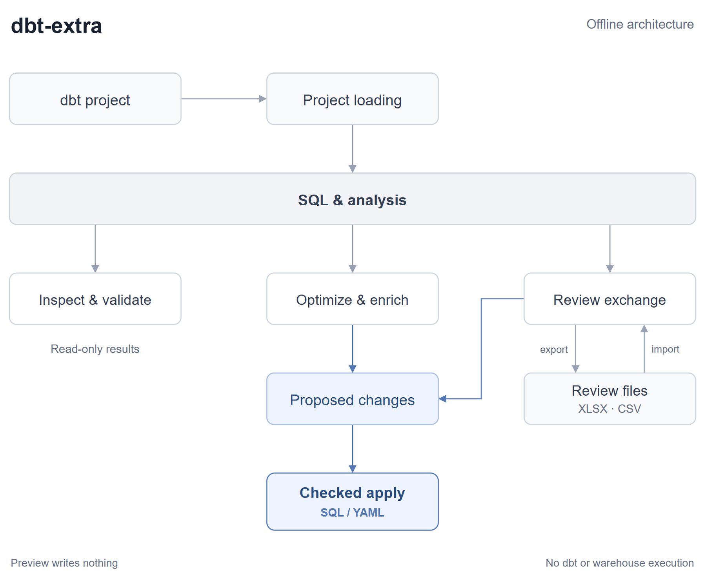

# Architecture

The public CLI is dbt-only and offline. It never invokes dbt or a warehouse.

[Edit the architecture diagram](architecture.drawio).

## Components

| Component | Responsibility |
| --- | --- |
| Entry points | CLI and Python API orchestrate workflows over shared components |
| Project loading | Discover dbt resources, resolve identities and source locations, and select scope |
| SQL & analysis | Parse and render SQL/templates; resolve references, dependencies, query scopes, types, lineage and coverage reasons |
| Inspect & validate | Expand upstream logic, prune columns, explain logical plans and check project structure |
| Optimize & enrich | Propose SQL/YAML improvements using shared project and analysis primitives |
| Review exchange | Export XLSX/CSV and read-only JSON; validate supported imports against baselines and source bindings |
| Change handling | Collect proposed edits, preserve YAML formatting, preview diffs and apply checked writes |

`Project` and `ChangeSet` are available from `dbt_extra`. Source-edit workflows return proposed
changes rather than writing implicitly; callers can inspect `diffs()` before
`apply()`.

## Boundaries

SQL and analysis do not depend on review formats. Scoped SQL rewrites belong
to the shared SQL layer, not review serializers.

Stable IDs and actual source locations remain separate from directory-only
`model_path`. Arbitrary templates are never executed; static macro previews use
an allowlisted AST interpreter with output/operation/depth limits, not dbt or
Jinja runtime execution. Manifest/catalog data is evidence,
never compiled-to-source reconstruction. Projects are operation-local snapshots.

## Checked writes

Writes assemble and validate complete proposed changes and check input snapshots.
Preview shows diffs without creating files. Apply stages sibling temporary files,
replaces targets, and attempts rollback after failures. No crash-safe transaction
or concurrency lock is claimed. Export writes review files only and never prunes.

## Development fixture

`examples/jaffle_shop` is the shared demo and native dbt integration fixture.
Run source-editing workflows against a temporary copy to preserve its teaching examples.
